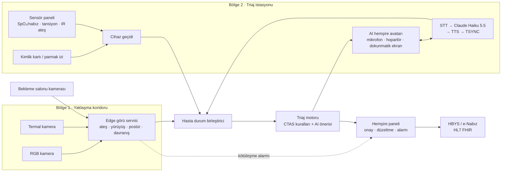

# EmergencyAI — Acil Servis AI Avatar Triaj Sistemi: Mimari

> Taslak v0.1 · 2026-10-21
> Kaynaklar: ekip ses kaydı (2026-10-21), CTAS kartı (CAEP/NENA), ATP↔CTAS renk eşlemesi,
> Lindner & Ravioli, *Am J Emerg Med* 94 (2025) 46–49 (SMASS vs MTS), in4medicine.ch (SMASS ürün sayfası).

## 1. Ana fikir

Hasta acile **yürürken** ölçülmeye başlanır. Termal ve RGB kamera ateşe, yürüyüşe, postüre ve
davranışa bakar. Hasta bir istasyona gelir ve elini sensöre koyar. Burada nabız, SpO₂, tansiyon
ve ateş ölçülür. Ekrandaki **canlı AI hemşire avatarıyla** Türkçe konuşarak şikâyetini anlatır.
Sistem bu verileri birleştirip **CTAS 1–5** seviyesi ve renk önerir. Sonuç hemşire paneline düşer ve
hasta ekrandan/sesle doğru alana yönlendirilir (bileklik veya etiket yazıcı yok). Kararı **triaj hemşiresi** onaylar: sistem karar destek aracıdır.

Ses kaydındaki ilkeler:
- Ekran soğuk bir "kiosk" gibi değil, **konuşan bir hemşire** gibi olmalı (canlı avatar).
- Bazı hastalar okuma yazma bilmiyor. Bu yüzden **ses birincil kanal**. Avatar hastayı
  anlamazsa, anladığına en yakın **4–5 seçenek** büyük butonlar ve piktogramlarla gösterilir.
- Bazı hastalar **imza atamıyor**. Bu yüzden imza yok: ilk girişte avatar onay ister ve hastanın
  **"onayladım" demesi imza yerine geçer** (§3.2).
- Kapsam **yalnızca yetişkin hastalar** (≥18). Çocuk hasta yok, pediatrik CTAS kullanılmaz.
- Fizik muayene yapılmıyor. Sistem dokunmasız ölçüm (kamera) ve hastanın kendi kullandığı
  temaslı sensörlerle sınırlı.
- Postür analizi modülü elimizde hazır, yeniden kullanılacak.
- Hasta tetkik seçmez. Ses kayıttaki "Tomografi ister misin?" örneği bunun neden olmaması
  gerektiğini gösteriyor. Sistem tetkik istemez, yalnızca hemşireye protokol önerisi sunar.

## 2. Makaleden çıkan dersler (SMASS neden başarısız oldu)

| SMASS bulgusu | Bizim tasarımda karşılığı |
|---|---|
| MTS "orange" hastaların %19'unu "non-urgent" sınıfladı (eksik triaj) | Asimetrik güvenlik: AI seviyeyi **yükseltebilir, kural motorunun altına indiremez** (§5) |
| SMASS'ın "non-urgent" dediklerinin %23'ü hastaneye yattı | Bekleme salonunda kamera ile sürekli yeniden değerlendirme ve CTAS süre takibi (§6) |
| Yazarlar başarısızlığı **vital bulguların modelde olmamasına** bağlıyor | Vital bulgular zorunlu girdi. CTAS birinci derece düzelticiler (modifier) uygulanıyor |
| Uyum çok düşük (Cohen's κ = 0,167) | Klinik çalışma hemşire CTAS'ına karşı paralel ve ileriye dönük yapılacak (§9) |
| Gerçek acil verisiyle eğitilmemiş | Kural tabanı CTAS/CEDIS listesine dayanıyor. Ayar yerel acil verisiyle yapılacak |

## 3. Bileşenler



### 3.1 Bölge 1: Yaklaşma koridoru (dokunmasız, 5–10 m)
- **Termal kamera:** Yüzden (iç göz köşesi) yüzey sıcaklığı ölçer. Bu yalnızca **tarama**
  amaçlıdır. Ortam sıcaklığı ve dışarıdan gelme ölçümü bozar, bu yüzden kesin değer istasyondaki
  temaslı termometreden alınır.
- **RGB ve poz tahmini:** Yürüyüş (topallama, asimetri, destekle yürüme), postür (öne eğilme,
  göğsü ya da karnı tutma) ve davranış (ajitasyon, sendeleme, düşme) analiz edilir. Mevcut postür
  modülü burada kullanılır.
- **Kritik bulgu kısayolu:** Düşme, yere yığılma, solunum güçlüğü postürü (tripod) ya da
  bilinç bulanıklığı görülürse hasta istasyona gönderilmez. **Hemşireye anında CTAS 1–2 alarmı**
  gider. CTAS 1–2 hasta ekran başında beklememeli.
- Kamera verisi istasyondaki oturuma bağlanır. Eşleştirme izleme kimliğiyle yapılır, yüz tanıma
  kullanılmaz.

### 3.2 Bölge 2: Triaj istasyonu
- **Temaslı sensörler:** Parmak pulse oksimetre (SpO₂ ve nabız), otomatik tansiyon manşonu,
  temassız alın termometresi. İsteğe bağlı olarak boy, kilo ve solunum sayısı (kameradan).
- **Kimlik:** T.C. kimlik kartı okuyucu ve MEDULA provizyonu. Kimlikteki doğum tarihi 18'den
  küçükse oturum açılmaz ve hemşire çağrılır.
- **Sözlü onay (imza yerine):** İlk girişte avatar aydınlatma metnini kısa ve sade Türkçeyle
  sesli okur (ekranda da yazar) ve onay ister. Hastanın **"onayladım"** demesi onay sayılır.
  Kanıt olarak şunlar saklanır: onay anının ses kesiti, transkript, okunan metnin sürümü,
  zaman damgası, istasyon ve kimlik bilgisi. Hasta onaylamazsa ya da cevap anlaşılmazsa avatar
  bir kez tekrar sorar, sonra hemşire çağrılır ve klasik triaja geçilir.
- **AI hemşire avatarı:** Hastanın karşısında tam boy ekran. Aynı ekranda büyük butonlar ve
  piktogramlar (ağrı yüzleri skalası, vücut haritasında ağrı yerini gösterme) bulunur.

### 3.3 Diyalog servisi ve avatar (tamamen Claude)

Tek LLM sağlayıcısı Claude'dur; Gemini kullanılmaz. Claude ses üretmediği için hat
**STT → Claude → TTS → TSYNC → avatar** şeklindedir. Seviyeyi yine Claude değil, kural motoru belirler.

| Katman | Sistem | Neden |
|---|---|---|
| Konuşma tanıma | **faster-whisper** (yerel GPU, akışlı, Türkçe) + VAD | Ses hastaneden çıkmaz |
| Görüşme + bilgi çıkarımı | **Claude Haiku 5.5** (`claude-haiku-5-5`), effort `low`, streaming | En hızlı ve en ucuz güncel Claude |
| Ses sentezi | Türkçe TTS, akışlı (seçim açık, §11) | Claude ses üretmiyor |
| Dudak senkronu | **TranscriptionSync (TSYNC)** | TTS'in ses akışından avatarın ağzını sürer (streaming CTC, P95 ≈ 0,48 sn) |
| Avatar | **Atlas renderer** (Three.js, ARKit 52 blendshape) + gerçekçi hemşire modeli (CC4/Avaturn GLB) | Atlas hazır, sadece model değişir |
| Seviye | **CTAS kural motoru** (yerel, deterministik) | LLM seviyeyi düşüremez (§5) |

Her hasta cevabında tek bir Claude çağrısı yapılır ve iki çıktı alınır:
1. **Söylenecek cümle** (metin, streaming): ilk cümle tamamlanır tamamlanmaz TTS'e gider,
   Claude'un geri kalanını beklemeden avatar konuşmaya başlar.
2. **`record_findings` tool çağrısı** (`strict: true`): CEDIS şikâyet kodu, başlangıç, ağrı 0–10,
   kırmızı bayraklar, ilaç/alerji, **güven skoru**. Bu veri kural motoruna gider.

Kurallar:
- Sistem talimatı sabit ve önbellekli (prompt caching): kısa, sade Türkçe, tıbbi terim yok,
  teşhis ve tetkik önerisi yok, sırayla şikâyet → başlangıç → ağrı → kırmızı bayrak soruları.
- Hangi sorunun sorulacağını kural motoru belirler (eksik alan listesi); Claude yalnızca soruyu
  doğal Türkçeyle söyler.
- **Belirsizlik:** güven düşükse ekranda en yakın 4–5 seçenek büyük buton + piktogramla çıkar.
  İki tur sonra hâlâ anlaşılmazsa **hemşire çağrılır**.
- Kritik cevap (göğüs ağrısı, nefes darlığı, bilinç vb.) geldiği anda motor alarm üretir;
  görüşmenin bitmesi beklenmez.
- Claude'a yalnızca metin gider; TC ve ad maskelenir.

Gecikme bütçesi (hasta sustuktan sonra avatarın konuşmaya başlaması, hedef < 1,5 sn):
VAD sonu ~0,3 sn + STT son parça ~0,2 sn + Claude ilk cümle ~0,5 sn + TTS ilk ses ~0,3 sn.
Prototipte ölçülecek; tutmazsa ilk önlem bekleme sırasında avatarın kısa onay sesi
("Anladım…") ve TTS'in yerelde çalıştırılması.

**Yedek:** Claude API erişilemezse buton tabanlı CTAS akışı (§7). Kural motoru yerelde çalışır.

**Dil:** İlk sürüm Türkçe. Sonra Arapça, Kürtçe, Farsça ve İngilizce; dil hastanın
ilk cümlesinden algılanır.

## 4. Veri modeli (özet)

```
TriageSession
  id, started_at, station_id, patient_ref (TC/MEDULA)
  consent:   { given, phrase_transcript, audio_clip_ref, notice_version, at }
  approach:  { skin_temp_c, gait_flags[], posture_flags[], behaviour_flags[], alarm? }
  vitals:    { hr, spo2, sbp, dbp, temp_c, rr?, measured_at, source }
  interview: { cedis_code, complaint_text, onset, pain_score, red_flags{}, meds[], allergies[],
               transcript_ref, language, confidence }
  engine:    { rule_level, ai_level, final_proposed_level, reasons[] }
  nurse:     { confirmed_level, override_reason?, nurse_id, confirmed_at }
  timers:    { reassess_due_at }
```

## 5. Triaj motoru: asimetrik güvenlik

```
rule_level   = CTAS kuralları(ana şikâyet, birinci derece düzelticiler: vital, ağrı, bilinç,
                                 mekanizma; ikinci derece düzelticiler: şikâyete özgü)
ai_level     = LLM + sensör/kamera bulgularından gelen öneri
proposed     = min(rule_level, ai_level)        # CTAS'ta küçük sayı = daha acil
herhangi bir kritik bulgu (SpO₂<90, SKB<90, bilinç↓, düşme vb.) → proposed = 1 veya 2 ve anında alarm
```

- **Üçüncü görüş (Faz 4, yerel veri biriktikten sonra):** Demografi + vital bulgular + şikâyet +
  uzman kuralı metnini birleştirip bir dil modeliyle kodlayan ve **belirsizlik tabanlı
  sınıflandırıcıyla** (evidential / Dirichlet çıktısı) seviye veren bir model. Bu model de seviyeyi
  yalnızca yükseltebilir. Asıl katkısı belirsizlik ölçüsüdür: **belirsizlik yüksekse
  karar otomatik olarak hemşireye gider**, sistem tahminde ısrar etmez.
- Kural motoru deterministik ve sürümlüdür, her karar için **gerekçe** listesi üretir.
- AI seviyeyi yalnızca **yükseltebilir**. Böylece aşırı triaj (overtriage) kabul edilir,
  eksik triaj (undertriage) engellenir.
- Seviye **hemşire onayı olmadan kesinleşmez**. Hemşirenin yaptığı her düzeltme gerekçesiyle
  kaydedilir ve kalibrasyon verisi olur.
- Renk eşlemesi (ATP tablosu): CTAS I–III **Kırmızı**, IV **Sarı**, V **Yeşil**. Bu eşleme
  hastanenin kullandığı renk sistemine göre yapılandırılabilir.

## 6. Yönlendirme ve yeniden değerlendirme

| CTAS | Hemşire değerlendirme hedefi | Yeniden değerlendirme | Yönlendirme |
|---|---|---|---|
| 1 Resüsitasyon | Hemen | Sürekli | Resüsitasyon odası, anında alarm |
| 2 Acil | Hemen | 15 dk | Kırmızı alan |
| 3 Aciliyetli | ≤30 dk | 30 dk | Kırmızı/sarı alan |
| 4 Az acil | ≤60 dk | 60 dk | Sarı alan |
| 5 Acil değil | ≤120 dk | 120 dk | Yeşil alan / poliklinik |

- Bekleme salonu kamerası aynı görü servisini kullanarak kötüleşme işaretlerini (düşme, yığılma,
  postür değişimi) izler.
- Yeniden değerlendirme süresi dolan hasta için ekranda uyarı çıkar ve avatar kısa bir kontrol
  görüşmesi yapar.

## 7. Dağıtım

- **Hastane içi edge sunucusu (GPU):** Görü, STT, TTS ve avatar burada çalışır. Ham video ve
  ses **hastaneden çıkmaz** ve saklanmaz; yalnızca çıkarılan özellikler saklanır.
- **LLM:** Claude API'ye yalnızca metin gönderilir. Kimlik bilgisi göndermeden önce
  maskelenir (TC, ad). Kurumun KVKK ve sağlık verisi değerlendirmesi buna göre yapılmalı.
  Gerekirse yerel model yedeği eklenir.
- **Entegrasyon:** HBYS'ye HL7 FHIR ile bağlanır (Encounter, Observation, Condition, Flag).
  e-Nabız ve MEDULA kendi servisleriyle entegre edilir.
- **Dayanıklılık:** İnternet ya da LLM düşerse istasyon **buton tabanlı CTAS akışına** geçer.
  Kural motoru yerel çalıştığı için triaj durmaz.

## 8. Mevzuat ve güvenlik

- Yazılım tıbbi cihaz sayılır (AB MDR / TİTCK; SMASS Sınıf IIb). İlk faz **hemşire
  denetimli karar destek** olarak konumlanır.
- Gerekli dokümantasyon: ISO 13485 kalite yönetimi, IEC 62304 yazılım yaşam döngüsü,
  ISO 14971 risk yönetimi, KVKK açık rıza ve aydınlatma metni.
- Kamera alanları için tabela ve aydınlatma metni gerekir. Yüz tanıma yapılmaz.

## 9. Doğrulama planı (SMASS çalışmasının tersine ileriye dönük)

1. **Sessiz mod:** Sistem hemşireyle paralel çalışır ama kararı etkilemez. Hemşire CTAS'ı
   referans alınır. Ölçütler: κ (ağırlıklı), eksik triaj oranı (birincil güvenlik ölçütü),
   aşırı triaj oranı, sonuçlar (yatış, YBÜ, 48 saat içinde mortalite).
2. **Kabul eşiği (öneri):** Kırmızı hastalarda eksik triaj ≤ %5 ve ağırlıklı κ ≥ 0,7.
3. Ancak bu eşikler tutturulduktan sonra hemşire onaylı aktif kullanıma geçilir.

## 10. Yol haritası

| Faz | Kapsam |
|---|---|
| **0 · Prototip** | Avatar + Türkçe diyalog + CTAS kural motoru + vital bulguların elle girilmesi + hemşire paneli |
| **1 · İstasyon** | Sensör paneli (SpO₂, tansiyon, ateş), kimlik okuyucu, çevrimdışı buton akışı |
| **2 · Koridor** | Termal + RGB kamera, yürüyüş/postür/davranış, kritik bulgu kısayolu |
| **3 · Bekleme salonu** | Sürekli kötüleşme izleme, yeniden değerlendirme zamanlayıcıları |
| **4 · Klinik** | Sessiz mod çalışması, etik kurul, HBYS entegrasyonu, MDR/TİTCK dosyası |

## 11. Açık sorular

- Pilot hastane hangi triaj sistemini kullanıyor (CTAS, ESI, 3 renk)? Renk eşlemesi ona göre
  kesinleşecek.
- Sözlü onay metninin son hâli: hastane hukuk birimi ve KVKK sorumlusu metni onaylamalı.
- Hangi HBYS ve hangi entegrasyon yolu kullanılacak?
- Türkçe TTS seçimi: yerel (veri dışarı çıkmaz, ses kalitesi daha düşük) mi, bulut (daha doğal, metin dışarı çıkar) mı? Ticari lisansı kontrol edilmeli.
- Gerçekçi hemşire modeli: Character Creator 4 mü, Avaturn mu?
